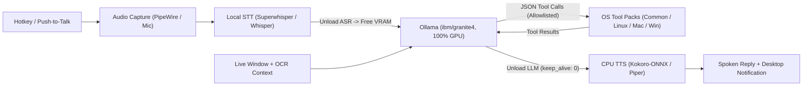

# Local Voice Agent

A 100% offline, privacy-first desktop voice & CLI agent engineered to run fast on a **4 GB VRAM** laptop GPU—with zero cloud APIs, zero raw shell execution, and customizable OS tool packs.

<!-- Demo Video -->
https://github.com/mananchothani2006/local-voice-agent/raw/main/assets/demo.mp4

> **[Watch the 2-minute live demo](assets/demo.mp4)** — showing `F10` push-to-talk, multi-step tool execution (`Omawrite` + volume `20% → 50%`), and CPU-only Kokoro voice confirmation on a 4 GB VRAM laptop.

---

## Architecture



---

## Engineering Highlights

* **4 GB VRAM Orchestration:** Coordinates dynamic GPU handoff—unloading the local ASR model right after transcription so the 3B LLM (`ibm/granite4`) runs on **100% CUDA**, then immediately evicting the LLM (`keep_alive: 0`) so GPU memory stays free for gaming or multitasking.
* **Security Over Raw Shell:** Instead of giving a small local model unrestricted `bash` access, all capabilities are exposed as **strictly validated JSON tool schemas** (path sandboxing, regex-checked app names, duplicate tool-call deduplication).
* **Zero-VRAM Voice Output:** Synthesizes natural speech purely on CPU via **Kokoro-82M (`kokoro-onnx`)** with **Piper TTS** fallback.
* **Modular OS Packs:** Core engine is OS-agnostic. Cross-platform tools live in `packs/common.py`, while Linux/Hyprland, macOS, and Windows integrations live in separate opt-in packs—so you can name your own assistant and enable only the skills for your OS.

---

## Quickstart

```bash
git clone https://github.com/mananchothani2006/local-voice-agent.git
cd local-voice-agent
./install.sh
```

The installer will:
1. Ask what you want to **name your assistant** (e.g., `Jarvis`, `Friday`, `Alfred`).
2. Detect your OS and enable the matching starter packs in `~/.config/local-voice-agent/config.json`.
3. Install a CLI wrapper so you can run `<your-assistant> "Set a 5 minute timer"` from any terminal.

### Prerequisites
* [Ollama](https://ollama.com/) with a JSON-tool-capable model (`ollama pull ibm/granite4`)
* Python 3.10+
* Optional TTS: `kokoro-onnx` + `numpy` (and `pw-play` / `aplay` on Linux)

---

## Project Layout

```text
local-voice-agent/
├── README.md
├── install.sh
├── config.example.json
├── agent/
│   ├── core.py          # Ollama JSON tool-calling loop, dedup, config & pack loader
│   └── tts.py           # Kokoro-ONNX (CPU) + Piper fallback
└── packs/
    ├── common.py        # Cross-platform: open_url, set_timer, find_file, open_path
    ├── linux_hyprland.py# Linux / Hyprland / PipeWire / Omarchy pack
    ├── macos.py         # macOS starter pack
    └── windows.py       # Windows starter pack
```

---

## Extending with Your Own Skills

Create a file in `packs/` (or `~/.config/local-voice-agent/packs/`) exposing `TOOLS` (Ollama JSON schemas) and `HANDLERS` (`{tool_name: fn(args) -> str}`), then add its name to `"packs"` in your `config.json`.
